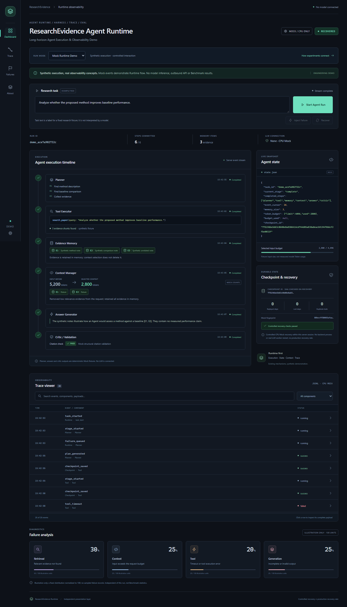
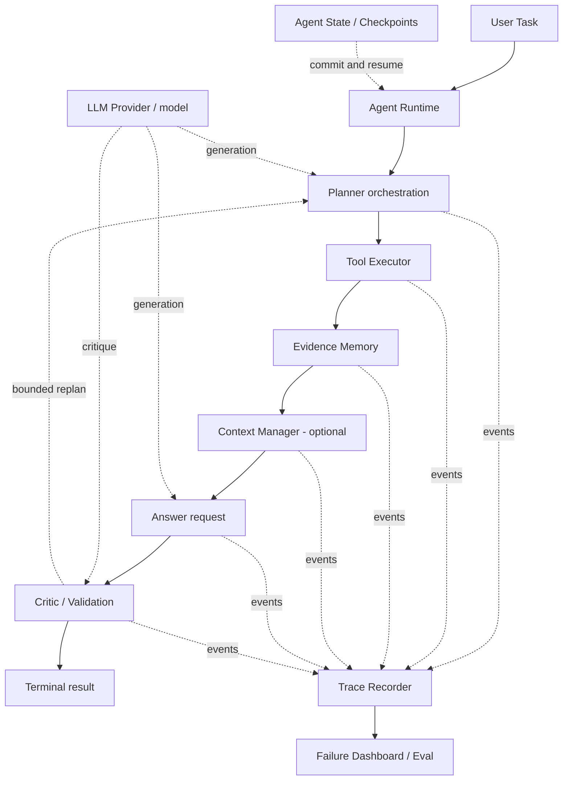

# ResearchEvidence Agent Runtime

An Agent Runtime for multi-step research tasks, built around **State, Tool execution, Evidence Memory, Checkpoints and Trace**. It coordinates planning, retrieval, context and answer validation with small models.

Explicit state and operation receipts help diagnose failures and resume eligible work without repeating completed calls. The CPU Demo makes task progress, evidence and recovery visible.

[Try the Demo](#demo) · [Architecture](docs/architecture.md) · [Runtime design](docs/runtime_design.md) · [Experiments](docs/experiments.md) · [Limitations](docs/limitations.md) · [Interview notes](docs/interview_notes.md)

## Demo



Follow a task from **Planner → Tool → Memory → Context → Answer → Validation**, inspect its State and Trace, then inject a failure and recover from a Checkpoint.

| Mode | What you can explore |
|---|---|
| Mock Runtime Demo | Start → Inject Failure → Recover; synthetic evidence and fixed answers, with local state/checkpoint files |
| Historical Trace Replay | Read-only playback of a recorded Agent Dev failure or a prior CPU Mock process restart |

**Demo boundaries:** this is **Runtime visualization, not a Benchmark**. Mock output is synthetic, not a model result. **Recovery Demo validates Runtime mechanisms, not production recovery rate or SLA.** The dashboard uses a separate CPU Actor; it does not execute the research Agent or call a model API. UI recovery works within the current backend session; playback leaves historical outcomes unchanged.

### Run locally

Use Python 3.11 and Node.js 24. From this release root:

```powershell
python -m venv .venv
.\.venv\Scripts\python.exe -m pip install -r requirements/demo.lock.txt
cd runtime_demo/frontend
npx pnpm@11.25.0 install --frozen-lockfile
npx pnpm@11.25.0 run build
cd ../..
.\.venv\Scripts\python.exe runtime_demo/backend/app.py
```

Open **http://127.0.0.1:8001**. macOS/Linux use `.venv/bin/python`. The FastAPI backend serves the React dashboard and streams events through SSE. No model download or GPU is needed. See the [three-minute walkthrough](docs/demo_guide.md#a-three-minute-walkthrough) and [startup guide](runtime_demo/README.md) for development and troubleshooting. Avoid entering private material in the task field.

## Runtime core

| Component | Implemented design |
|---|---|
| **State** | `AgentState` keeps the goal, plan, cursor, completed steps, evidence, receipts and remaining budget |
| **Tool** | Validated BM25 search/read requests, with request intent and outcome receipts |
| **Memory** | Evidence Store retains source identity, version and locators across task steps |
| **Context** | Budget-aware selection of whole evidence units; optional and off by default after the matched Dev study |
| **Checkpoint** | Committed state snapshots and receipt reuse let eligible work resume without repeating committed calls |
| **Trace** | A complete disk journal, bounded in-memory event tail and failure categories support diagnosis |
| **Agent loop** | Structured planning, answer generation, citation checks and bounded Critic/Replan |

Inspect the core in [`src/deepresearch`](src/deepresearch): [`state.py`](src/deepresearch/runtime/state.py), [`resumable_agent.py`](src/deepresearch/runtime/resumable_agent.py), [`context.py`](src/deepresearch/runtime/context.py) and [`trace_analysis.py`](src/deepresearch/runtime/trace_analysis.py). Checkpoint recovery preserves saved terminal outcomes, including failures; uncertain calls without receipts block automatic continuation. The runnable dashboard demonstrates these concepts through its separate Actor.

## Architecture



The **model** generates plans, answers and optional critique. The **Runtime** owns execution, tools, evidence, budgets and committed state. **Trace/Eval** makes outcomes inspectable. State, Checkpoints and Trace span the task loop. See the [layered architecture guide](docs/architecture.md) for the lifecycle and responsibilities.

## Research results

### Full-Agent study

Qwen2.5-1.5B-Instruct Q4_K_M with llama.cpp. B1–B3 assess retrieval, Planner, Memory and Critic/Replan; B4/B4off isolate source-identity deduplication; B5 is a small engineering diagnostic. The study saved **1,034 task observations**, including multiple configurations on shared questions.

| Frozen Final, all tasks per arm | B1 | B4 | B4off |
|---|---:|---:|---:|
| QASPER Answer F1, N=108 | 0.1672 | 0.1345 | 0.0747 |
| SciFact label accuracy, N=100 | 0.1000 | 0.0200 | 0.0000 |

**B4 improved over B4off but remained below B1**, and used more reported tokens than B4off. Failures stay in each metric's fixed denominator; completion is not correctness. A later matched 152-observation Dev extension studied state/Trace and optional Context selection. Context remains **off by default** after its quality/cost comparison; this extension is a Dev result.

### Independent SFT study

Qwen2.5-0.5B-Instruct BF16 base with LoRA SFT: 500 training samples from 360 papers; Dev/Test each contain 50 papers/50 tasks. The selected adapter was compared once with the base on frozen Test inputs.

| Independent Test, all 50 tasks per arm | Base P0 | LoRA P1 |
|---|---:|---:|
| Answer F1 | 0.0602 | 0.3533 |
| Evidence F1 | 0.0270 | 0.1080 |
| Complete protocol pass | 16/50 | 50/50 |

**SFT is a separate Answer-module experiment.** The adapter has not been integrated into or evaluated as the full Agent. The two studies use different models and evaluation contracts; their metrics cannot be merged or directly ranked. Protocol pass and evidence overlap do not establish human semantic correctness.

See [Experiments](docs/experiments.md) for denominators, costs, negative results and evaluation design, and [results_summary.json](docs/results_summary.json) for full-precision aggregates.

## Docker / Hugging Face Space

The Dockerfile builds the frontend and runs FastAPI as UID 1000 on port `7860`, using CPU web dependencies. To try it with Docker installed:

```bash
docker build -t research-evidence-runtime-demo .
docker run --rm -p 127.0.0.1:7860:7860 research-evidence-runtime-demo
```

**Status:** Docker Space configuration prepared; no hosted Space deployed. **container build not locally verified**. See [deployment limits](docs/limitations.md#deployment-and-storage) and the [Space setup guide](runtime_demo/README.md) before hosting.

## Scope and limitations

The public package contains the Runtime core, CPU Demo, selected tests, sanitized replay and aggregate research results. Benchmark Gold and original predictions are excluded, so historical aggregate scores cannot be independently recomputed from this snapshot. [Limitations](docs/limitations.md) covers recovery guarantees, citation validation, experimental scope and deployment constraints.

## License and attribution

Rights-cleared project contributions use **Apache-2.0**. Third-party rights and attribution are retained in [LICENSE](LICENSE), [NOTICE](NOTICE) and [LICENSES](LICENSES). No model weights, GGUF, LoRA adapter, raw paper text or private logs are bundled.
