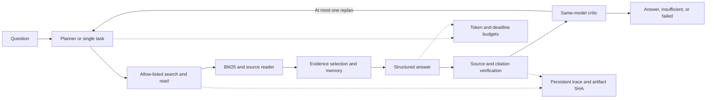

# ResearchEvidence Agent

**An evidence-grounded research agent with bounded planning, retrieval and verification for AI technical knowledge.**

This project studies whether a small local LLM benefits from planning, cross-query evidence memory, a critic and bounded replanning. It combines an inspectable BM25 workflow with immutable traces, native token accounting and controlled experiments. The result is deliberately reported in full: source-identity deduplication improved the complex agent relative to its component-off ablation, while the direct retrieval-and-answer baseline remained stronger on both frozen benchmark subsets.

The implementation, tests, execution and reporting were developed with Codex assistance. The owner specified the project direction and constraints and reviewed milestones. Individual implementation contributions require confirmation; the project does not claim that all code was independently handwritten. See [development attribution](docs/development_attribution.md).

## Start with the CPU demonstration

Python 3.11 or newer, standard library only:

```bash
python examples/public_demo.py
python scripts/verify_cpu.py
```

The demonstration uses project-authored synthetic text and a deterministic `MockProvider`. It requires no model, credentials, network or GPU; its output is an engineering example, **not real Agent performance**. The portable tests cover provider errors and retry limits, JSON validation, redaction, provenance, budgets and on/off memory controls. They deny real socket creation during discovery and execution.

Installation is optional: both commands use the included `src/` tree directly. Real benchmark execution has a separate scope, described under [reproduction boundaries](docs/public_reproduction.md).

## Architecture



- **Retrieval:** deterministic BM25, `k1=1.2`, `b=0.75`, top K=5. QASPER retrieves paragraphs within the supplied paper; SciFact retrieves sentences across the corpus. No trained embedding model or reranker is claimed.
- **Memory:** preserves document, source URL, version, chunk, text, hashes, spans and task associations. B4 deduplicates exact source identities while retaining distinct sources and first-occurrence evidence IDs.
- **Verification:** checks citation IDs, source registry, text spans and hashes. The critic uses the same 1.5B model as answering; it is workflow feedback, not an independent evaluation judge.
- **Execution:** an OpenAI-compatible provider, environment-only credentials, bounded transport retries, structured-output validation and native usage accounting. Tools are allow-listed; source text cannot authorize shell execution.
- **Resource control:** records system Available/Committed memory separately from process Private Bytes/Working Set and GPU device counters. The historical research runtime preserves its 1.25 GiB Available RAM floor and stops only owned computation.

## Experiment design

| Stage | Design | Observations |
|---|---|---:|
| R0 | BM25 retrieval reference, no LLM | Excluded from total |
| Original Dev | 36 QASPER + 40 SciFact tasks under B1/B2/B3 | 228 |
| B4 Dev | Same Dev tasks, source-identity deduplication on/off | 152 |
| B5 | Fixed-ID system/context engineering diagnostics | 30 unique observations |
| Frozen Final | 108 QASPER + 100 SciFact tasks under B1/B4/B4off | 624 |
| Total | Terminal task observations, including failures | **1034** |

B1 performs direct retrieval and answering. B2 adds a planner; B3 adds cross-round memory, a critic and at most one replan. B4 changes only the preregistered source-identity deduplication factor relative to B4off. The existing component was selected from complete Dev before Final; prompts, output JSON, evidence selection and budgets stayed fixed. Expected dictionary lookup is O(1), while each insertion costs O(hashed UTF-8 bytes + task-association count).

These are observation counts, not unique-question counts or model-call counts. Existing terminal failures were retained rather than resampled until correct. Development selection and frozen Final remained separate. See [evaluation protocol and denominators](docs/public_evaluation.md) and [B4 implementation](docs/b4_algorithm_explained.md).

## Frozen Final results

The formal model was official Qwen2.5-1.5B-Instruct Q4_K_M with llama.cpp b9757, temperature 0, seed 11 and explicit `--cache-ram 0`. Standard context/input/output caps were 4096/3072/512 tokens, worst-case total reservation 24000, logical model calls 8, tools 18, subtasks 4, replans 1 and task deadline 120 seconds. No fine-tuning was performed.

| Benchmark | System | Fixed n | Runtime failures | Insufficient evidence | Answer F1 / Label Accuracy | Evidence F1 / Sentence-label micro F1 |
|---|---|---:|---:|---:|---:|---:|
| QASPER | B1 | 108 | 39 | 0 | **0.1672** | **0.1345** |
| QASPER | B4 | 108 | 53 | 0 | 0.1345 | 0.1221 |
| QASPER | B4off | 108 | 68 | 0 | 0.0747 | 0.0871 |
| SciFact | B1 | 100 | 3 | 0 | **0.1000** | **0.0524** |
| SciFact | B4 | 100 | 71 | 13 | 0.0200 | 0.0141 |
| SciFact | B4off | 100 | 89 | 3 | 0.0000 | 0.0000 |

Failures remain in the fixed quality denominators: 323 runtime failures and 16 insufficient-evidence outcomes are recorded separately. These are selected-subset results, not full benchmark leaderboard scores; the two benchmarks are not averaged into one accuracy.

QASPER B4−B4off Answer F1 was +0.0598 absolute, with paired cluster interval [0.0246,0.1016]. SciFact label accuracy was +0.0200, with interval [0.0000,0.0510]. The preregistered analysis used 2000 cluster-bootstrap draws, seed 20261009 and 108 paper clusters / 95 source-connected clusters. **B4 remained below B1**, and a single-seed public subset does not establish a universal gain.

| Benchmark | System | Reported input + output tokens | Mean tool calls | Warm task latency P50 / P95 (ms) |
|---|---|---:|---:|---:|
| QASPER | B1 | 233696 | 5.96 | 2460.5 / 3062 |
| QASPER | B4 | 421391 | 8.81 | 3156 / 3734 |
| QASPER | B4off | 292422 | 8.76 | 2250 / 3734 |
| SciFact | B1 | 140277 | 6.00 | 703 / 2203 |
| SciFact | B4 | 714763 | 16.14 | 3203 / 4390 |
| SciFact | B4off | 684550 | 16.38 | 3125 / 3953 |

Token totals include sent failed attempts and exclude requests rejected before sending; conservative reservations are not actual usage. Warm task latency includes worker startup, corpus preparation and tokenizer RPC, with cold load separate. Smaller repeated contexts allowed more calls to proceed and did not yield uniform cost reduction. Historical cache-on/off Dev efficiency is stratified. B5 uses only three tasks per benchmark/system, and 27 historical per-row cold-load values remain null because their provenance is ambiguous.

Exact aggregate results, configuration metadata and the original local audit SHA are retained in [release evidence](docs/release_evidence.json). Raw predictions, Gold, traces and private machine information are excluded from this release scope.

## Reproduction and limitations

The included source supports inspection and portable synthetic engineering checks. It does **not independently recreate the exact 624 Final observations**: the private research controller, frozen task identities/Gold, raw data, model weights, binaries, environments and original research Git history are not bundled. Restoring public upstream archives alone does not reconstruct the exact selected task set. Any later task-manifest or extraction release requires its own reviewed scope.

QASPER uses selected text-locatable official-test questions, one per paper. SciFact Final uses selected public official-dev Gold, not the hidden official test. Public pretraining exposure is unknown, only one model/seed was studied, and the original AI/ML vertical corpus was not evaluated in this formal comparison. Scientific QA and claim verification are proxy tasks for the intended knowledge-base setting.

Citation Support Rate and Unsupported Claim Rate are **null**: no independent human output-semantic review was completed. Evidence F1, source-span validity and ID membership cannot substitute for semantic citation accuracy. The same-model critic is neither Gold nor a second reviewer.

## License and acknowledgements

Project contributions are licensed under [Apache-2.0](LICENSE). Copyright attribution: **xiaolei-aba**. Third-party notices and scoring ancestry are retained in [NOTICE](NOTICE) and the complete [SQuAD MIT notice](LICENSES/SQuAD-MIT.txt). The project license does not relicense model weights, datasets, paper text or backend/CUDA binaries, which are not bundled.

The public scorer adds the reviewed provenance/modification comment to the unchanged frozen research body; executable AST and scoring behavior are unchanged. See [release manifest](RELEASE_MANIFEST.json) for original and public hashes and [reproduction boundaries](docs/public_reproduction.md).

Upstream origins are recorded in [source lock](data/benchmarks/source_lock.json). The implementation and experiments used Codex assistance; see [authorship boundary](docs/development_attribution.md). Career materials: [Chinese/English resume bullets](docs/resume_bullets.md), [interview guide](docs/interview_guide.md).
