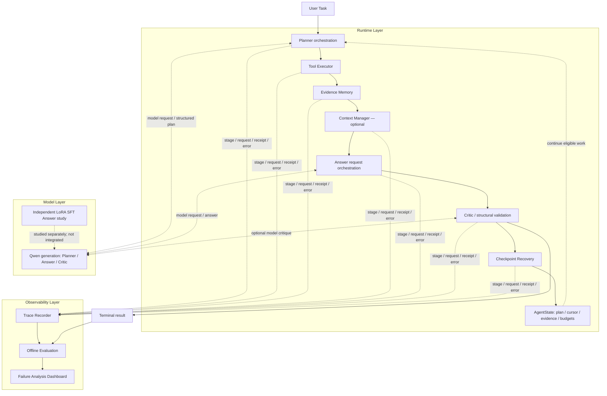

# Architecture

ResearchEvidence Agent Runtime coordinates research tasks that need a plan, several evidence operations, a constrained answer, and an inspectable execution history. The model generates plans and answers; the runtime owns execution, budgets, state, and recovery rules.

The public dashboard is a CPU demonstration of those mechanisms. Its Mock Actor does not load the research models. Historical Trace Replay displays sanitized recorded events without executing the recorded task. Aggregate research results are documented separately in [Experiments](experiments.md).

## Three layers

Critic and Context Manager have independent switches. A model critique is not independent human validation. A checkpoint is updated at committed boundaries throughout execution; the diagram's recovery node does not mean checkpointing happens only after the final answer.

| Layer | Responsibilities | Evidence available here |
|---|---|---|
| Model | Structured plans, evidence-conditioned answers, optional critiques | Aggregate 1.5B Agent results and a separate 0.5B LoRA Answer comparison |
| Runtime | Tool validation, evidence provenance, request budgets, explicit state, eligible checkpoint resume | Public core source and CPU tests, plus a runnable bounded CPU Mock Actor |
| Observability | Event history, state snapshots, failure categories, fixed-denominator evaluation | Dashboard, sanitized replay fixtures, aggregate results |

## One task through the system

1. **Enter and identify the task.** Bind the task to its configuration and execution identity. A matching saved terminal result remains terminal, including a normal failure.
2. **Plan.** When enabled, ask the model for a structured plan and validate it. B1 uses a fixed retrieval path; additional planning is an experimental choice.
3. **Execute tools.** Validate search/read requests and their results. Record request intent, outcome, latency, and error category.
4. **Update evidence.** Retain source identity, version, hash, and locator with each evidence unit. Evidence Memory stores task state rather than changing model parameters.
5. **Prepare context.** The optional selection policy keeps whole evidence units within the request budget. Stored evidence and the subset supplied to one model request are separate objects.
6. **Generate an answer.** The model receives the permitted evidence and output protocol. Input checks and output reservations can reject a request before generation.
7. **Validate.** Check output structure and citation identity; optionally run the same-model Critic and a bounded replan. Citation membership alone does not establish semantic support.
8. **Commit and observe.** Save state and receipts at execution boundaries, append trace events, then produce a terminal result for the frozen offline scorer.

## What is implemented, studied, and demonstrated

The historical research implementation contains Planner, BM25 search/read, EvidenceStore, Critic/Replan, native request counting, durable AgentState, fingerprint/SHA checks, and a full disk journal. The Context Manager candidate remains available but is **off by default** after its matched Dev quality/cost comparison.

This public snapshot packages the core runtime source and selected CPU tests, the dashboard and its separate CPU Mock Actor, demonstration checkpoints, sanitized historical event fixtures, documentation, and aggregate results. It is not a complete redistribution of research inputs or a one-command reproduction of the frozen Benchmark runs. It includes no model weights, Adapter, Gold, raw predictions, or private traces.

The two research studies share a project direction rather than a common measurement denominator. The 1.5B GGUF Agent was not replaced by the 0.5B BF16 LoRA model. See [Experiments](experiments.md) for the boundary and [Runtime Design](runtime_design.md) for recovery guarantees and limits.
